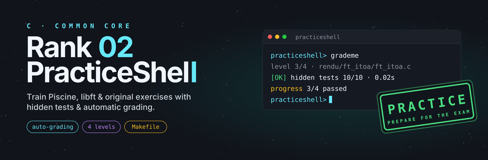
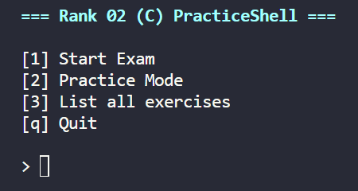
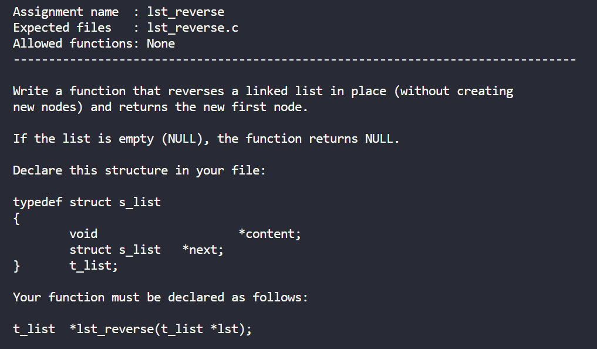
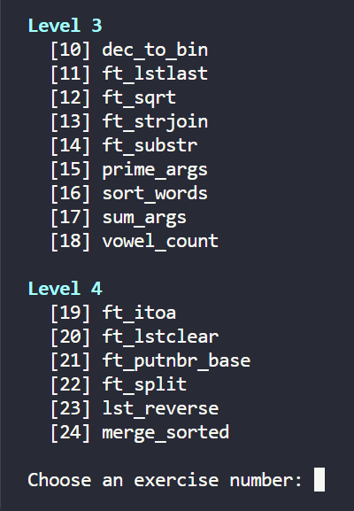

<p align="center">
  
</p>

<br>

<h1 align="center">Rank 02 (C) PracticeShell - Exercises & Solutions</h1>

<br>


> [!WARNING]
> This repository does **not** contain the real Rank 02 exam subjects or solutions. The PracticeShell uses classic **Piscine** and **libft** exercises, plus **original exercises** inspired by the exam's difficulty levels. They are great for training, but they are **not** the actual exam questions.


---

# 💡 About

This repository is a **growing bank of exercises** for the C topics learned during the Piscine and the first projects of the Common Core.

The goal is to help you:

- **Train** the topics you learned (strings, pointers, `malloc`, linked lists...)
- **Review** your doubts and find your weak points
- **Prepare** for the exam by practicing under time and test pressure.

New exercises will be added over time. Each one focuses on a concept you need for the exam.

---

<br>
<p align="center">
  
</p>


<p align="center">
  <a href="#-quick-start">Quick Start</a> •
  <a href="#-main-feature-practiceshell-simulator">Features</a> •
  <a href="#-exam-mode">Exam Mode</a> •
  <a href="#-practice-mode">Practice Mode</a> •
  <a href="#-solutions">Solutions</a>
</p>

---

A C-based **PracticeShell simulator** inspired by the 42 School Common Core Rank 02 exam, combined with a collection of organized solutions grouped by difficulty level.

---

# 🚀 Quick Start

Clone the repository:

```bash
git clone https://github.com/SaraFreitas-dev/42_Exam_Rank02.git
cd 42_Exam_Rank02
```

Build and run the PracticeShell:

```bash
make
./practiceshell
```

You will be presented with the main menu:

```text
[1] Start Exam
[2] Practice Mode
[3] List all exercises
[q] Quit
```

No dependencies, no setup: just `cc` and `make`.

---

## 📝 Workspace

When the PracticeShell starts, it automatically creates a `rendu` directory. When you get an exercise, its subject appears in a `subject` directory, just like in the real exam. Only the current subject is there.

All exercise files should be created inside `rendu`, each one in a subfolder with the exercise name. The grader will only validate solutions placed in the generated workspace.

Example:

```text
subject/
└── ft_strlen/
    └── subject.txt

rendu/
└── ft_strlen/
    └── ft_strlen.c
```

Simply create the requested file, implement your solution, and submit it through the PracticeShell interface for automatic evaluation.

---

# ⭐ Main Feature: PracticeShell Simulator

The PracticeShell is the core of this repository.

It lets you practice each topic hands-on, with hidden tests and automatic feedback, instead of just reading solutions.

<p align="center">
  
</p>

| Grading | Exam experience | Interface |
|---|---|---|
| Automatic grading | Random exercise assignment | Colored terminal UI |
| Hidden test cases | Progressive level system | Score tracking |
| Compiled with `-Wall -Wextra -Werror` | Exam & practice modes | Time tracking |
| 4 difficulty levels | Rank progression logic | Built with Makefile |

The workflow:

1. Receive a subject
2. Create the requested C file
3. Implement the solution
4. Submit for grading
5. Fix failing tests
6. Progress to the next level

<br>
<p align="center">
  
</p>

---

# 🎯 Exam Mode

Select:

```text
[1] Start Exam
```

The simulator will:

- Assign exercises automatically
- Increase difficulty after each successful exercise
- Track your score
- Simulate a 3-hour exam session

## 🏆 Passing the Exam

The simulator uses a progressive difficulty system.
To successfully complete the exam you must validate:

```text
4 / 4 exercises
```

---

# 🛠 Practice Mode

Select:

```text
[2] Practice Mode
```

Practice Mode allows you to:

- Choose any exercise
- Focus on a specific level
- Submit unlimited times
- Train without time pressure

---

# 📚 Solutions

Solutions are organized by level. Each exercise has its own folder with the subject and the solution.

```text
solutions/
├── Level_1/
│   └── ft_strlen/
│       ├── ft_strlen.c
│       └── subject.txt
├── Level_2/
├── Level_3/
└── Level_4/
```

This makes it easy to study specific difficulty ranges or review previously solved exercises.

> ⚠️ Try each exercise in the PracticeShell first. Reading solutions before attempting them will not show you where your weak points are.

---

# 📖 Topics Covered

- `write` and string printing
- String manipulation and transformations
- Argument handling (`argc` / `argv`)
- Number conversion (`atoi`, `itoa`, binary, bases)
- Bitwise operations
- Memory allocation with `malloc` and `free`
- Splitting and joining strings
- Linked lists
- Sorting
- Recursion and grid problems
- Edge case handling
- Algorithmic thinking

---

## ⚠️ Disclaimer

This project is an independent educational tool.
It is not affiliated with or endorsed by 42 School, and it does not contain any official 42 exam content.

---

## 💡 Suggestions

Found a bug, a missing test case or have an idea? Feel free to [open an issue](https://github.com/SaraFreitas-dev/42_Exam_Rank02/issues).

---

## ⭐ Support

<h3 align="center">If this repository helped you prepare for the exam, consider giving it a star ⭐</h3>

<p align="center">Good luck and happy coding 🚀</p>